# DMS - Telecom: P2 Project Implementations Context

The following document details the new implementations and observations from the administrator and server for the P2 software project. This documentation is based on the reference file named "Report_Context.docx".

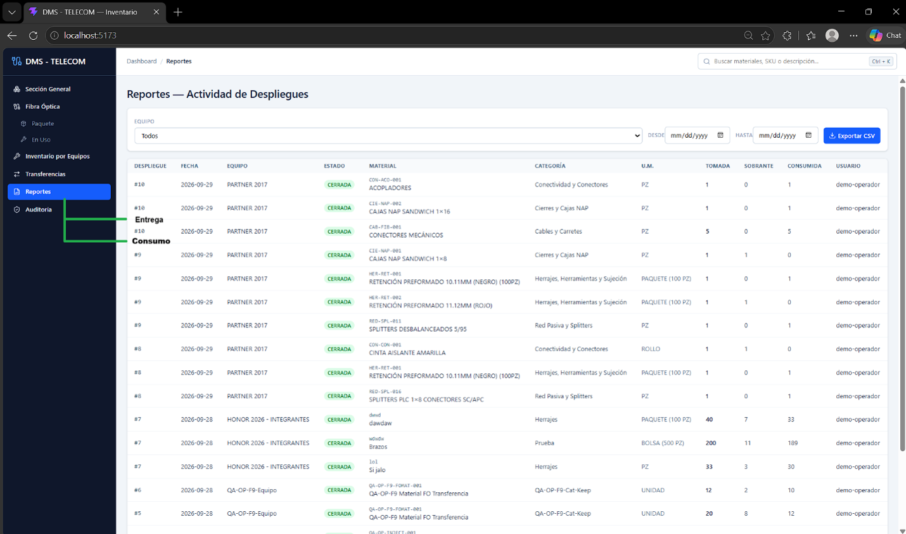

Currently, the reports section allows searching by team, by date range, and generating a report based on that; it fulfills the basics and is correct. New observations arose, meaning the report will no longer be a single-phase report. The only report section currently is "Actividad de Despliegues" (Consumption Activity). A new section will also be generated within the reports section to export reports, which is "Entrega de Materiales" (Generated by the confirmation of materials delivered to the corresponding team in the TEAMS function when clicking the "confirmar TEAMS" button). Reports will now be exported in .xlsx format, no longer in .csv.

---

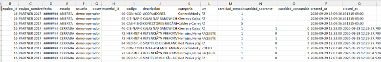

This is the old format that needs to be replaced by the new and official one; therefore, this format is discarded.

---

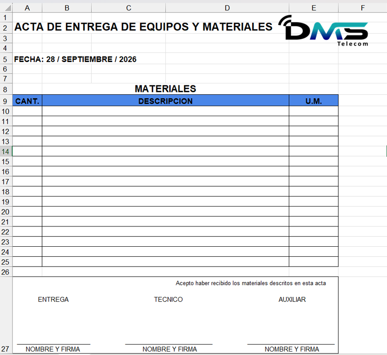

New official format.

---

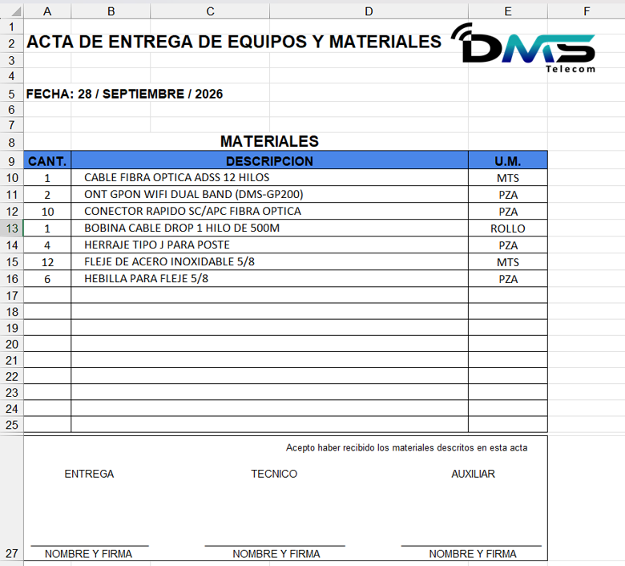

This is an example of how the new official format (1st Format - Normal) looks when materials are registered for a report with their respective characteristics, in order to replace the previous format with this one.

---

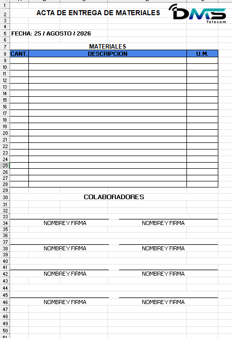

This is the second official format, which is extensive (2nd Format - Extensive).

---

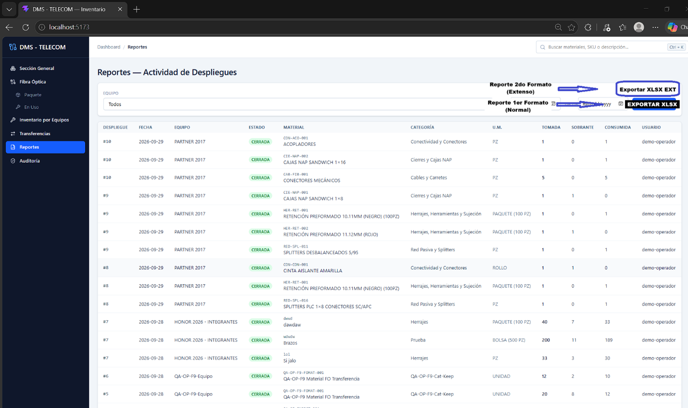

To include the option for both types of formats (Normal and Extensive), this is the design that each subsection of the reports section will have ("Entrega" and "Consumo").

---

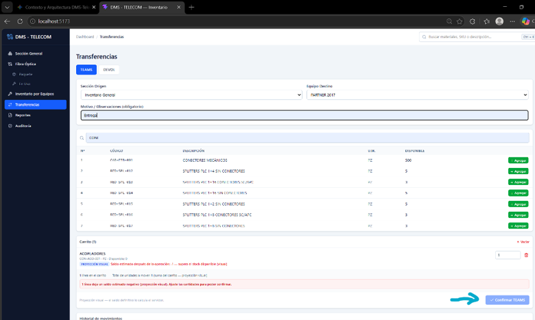

In total, two reports will be generated: one is created during the material transfer when confirmed from the TEAMS section delivering said materials to a specific team, and the other is generated when closing the DESPLIEGUE (CONSUMO). The DESPLIEGUE function will no longer be named DESPLIEGUE, but will be renamed to CONSUMO.

---

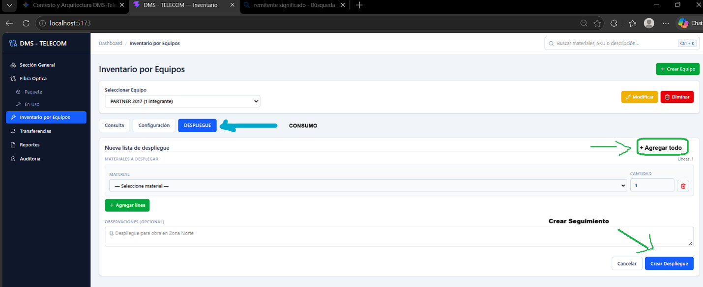

For the "Inventario por Equipos" section inside the DESPLIEGUE (CONSUMO) function, the name change of the function to CONSUMO is added. A new functionality called "Agregar todo" is added, with its location demarcated as a button in the image; its function is to completely add the entire inventory with all the existing quantity of the team's own and independent inventory for which the consumption is designated. For a coherent nomenclature, the current "Crear Despliegue" is changed to "Crear Seguimiento", a nomenclature aligned with tracking the consumption by the team with the assigned materials, for the closure with the registration of the remaining materials and quantities (Once the closing of the consumption tracking is confirmed, the consumption report is generated there).

---

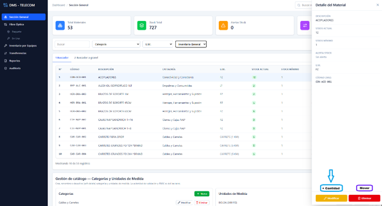

Add a new function required for operational functionality. This new function will be called "+ Cantidad", and it will be available for any type of material, both those appearing in the general inventory and those in the fiber optic inventories. What this function does is simply allow adding quantity to the already existing stock quantity. For example, adding "50 +" to the selected material will ultimately sum the described quantity to the current stock quantity, without implementing any other function over it. Specifically, it is an addition function aimed at the existing quantity of the current stock, for example: Quantity = 50 + 3 of "CAJAS NAP SANDWICH 1 X 16".

---

### Objective:
Allow the administrator to easily attach material directly, reducing the need to perform basic manual arithmetic calculations that counteract operational efficiency time.

---

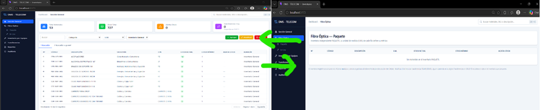

Currently, materials cannot be transferred between the general inventory and the fiber optics section inventories. To move materials from inventory to inventory without having to create a new function with the behavior of teams or devol, something more direct is needed, because the company does not require anything so robust in this section. Only the option to move materials directly when specifically required is needed. That is, alongside the existing options ("Modificar" and "Eliminar") and the one to be implemented ("+Cantidad") that are displayed when selecting a given material, a new function called "Mover" is needed.

---

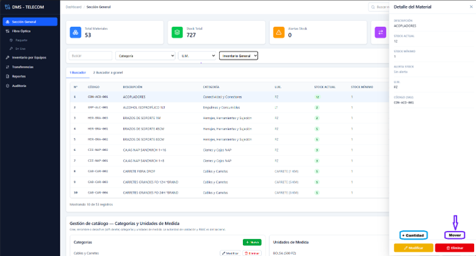

This new function to be implemented only allows moving materials between inventories. When selecting this option, a display should appear with a select box menu of the existing inventories. Like, for example:

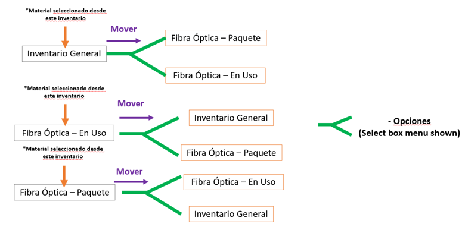

---

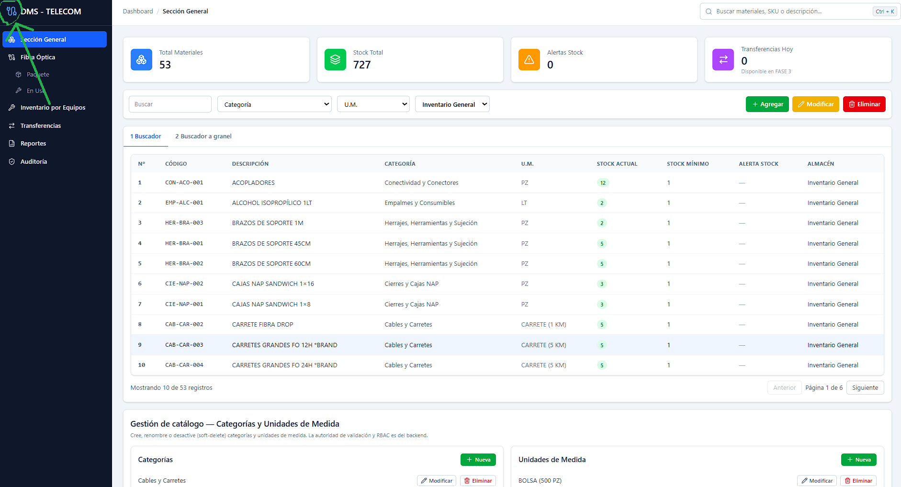

The insertion of the company logo in the top-left corner is required.
Company logo:

---

## DMS - TELECOM (P2)
│
├── REPORTES
│   │
│   ├── Estado Actual
│   │   ├── Búsqueda por equipo
│   │   ├── Búsqueda por rango de fechas
│   │   └── Generación de reportes básicos
│   │
│   ├── Cambio General
│   │   ├── Exportación deja de ser CSV
│   │   └── Exportación pasa a XLSX
│   │
│   ├── Subsección: ENTREGA DE MATERIALES
│   │   │
│   │   ├── Origen
│   │   │   └── Generado al confirmar TEAMS
│   │   │       └── Botón: "Confirmar TEAMS"
│   │   │
│   │   ├── Formatos disponibles
│   │   │   ├── Formato Normal (Oficial)
│   │   │   └── Formato Extensivo (Oficial)
│   │   │
│   │   └── Reemplazo de formato
│   │       ├── Formato antiguo → DESCARTADO
│   │       └── Formatos oficiales → NUEVOS
│   │
│   ├── Subsección: CONSUMO
│   │   │
│   │   ├── Cambio de nombre
│   │   │   └── DESPLIEGUE → CONSUMO
│   │   │
│   │   ├── Formatos disponibles
│   │   │   ├── Formato Normal (Oficial)
│   │   │   └── Formato Extensivo (Oficial)
│   │   │
│   │   └── Generación de reporte
│   │       └── Al cerrar el seguimiento de consumo
│   │
│   └── Resultado Final
│       ├── Reporte 1: Entrega de Materiales
│       │   └── Generado desde TEAMS
│       │
│       └── Reporte 2: Consumo
│           └── Generado al cierre del seguimiento
│
├── CONSUMO (antes DESPLIEGUE)
│   │
│   ├── Cambio de nombre
│   │   └── DESPLIEGUE → CONSUMO
│   │
│   ├── Inventario por Equipos
│   │   │
│   │   ├── Nueva función: "Agregar todo"
│   │   │   ├── Toma todo el inventario del equipo
│   │   │   ├── Incluye todas las cantidades existentes
│   │   │   └── Lo agrega al consumo actual
│   │   │
│   │   └── Cambio de nomenclatura
│   │       └── "Crear Despliegue"
│   │           → "Crear Seguimiento"
│   │
│   └── Cierre
│       └── Genera reporte de consumo
│
├── INVENTARIOS
│   │
│   ├── Función nueva: "+Cantidad"
│   │   │
│   │   ├── Disponible para:
│   │   │   ├── Inventario General
│   │   │   ├── Fibra Óptica Paquete
│   │   │   └── Fibra Óptica En Uso
│   │   │
│   │   ├── Acción
│   │   │   └── Suma cantidad al stock actual
│   │   │
│   │   └── Ejemplo
│   │       └── Stock 3 + Cantidad 50 = 53
│   │
│   └── Objetivo
│       └── Evitar cálculos manuales del administrador
│
├── MOVIMIENTO ENTRE INVENTARIOS
│   │
│   ├── Problema actual
│   │   └── No se pueden mover materiales
│   │       entre inventarios directamente
│   │
│   ├── Nueva función: "Mover"
│   │   │
│   │   ├── Aparece junto a:
│   │   │   ├── Modificar
│   │   │   ├── Eliminar
│   │   │   └── +Cantidad
│   │   │
│   │   ├── Función
│   │   │   └── Transferir materiales
│   │   │       entre inventarios
│   │   │
│   │   └── Interfaz
│   │       └── Select Box
│   │           └── Inventario destino
│   │
│   └── Restricción
│       └── No utiliza lógica compleja
│           de TEAMS o DEVOL
│
└── INTERFAZ GENERAL
    │
    └── Branding
        └── Insertar logo oficial
            └── Esquina superior izquierda

          
### High-Level Summary

P2
│
├── REPORTES
│   ├── ENTREGA
│   │   ├── Formato Normal
│   │   └── Formato Extensivo
│   │
│   └── CONSUMO
│       ├── Formato Normal
│       └── Formato Extensivo
│
├── CONSUMO
│   ├── Agregar todo
│   └── Crear Seguimiento
│
├── INVENTARIOS
│   ├── +Cantidad
│   └── Mover
│
└── UI
    └── Logo corporativo